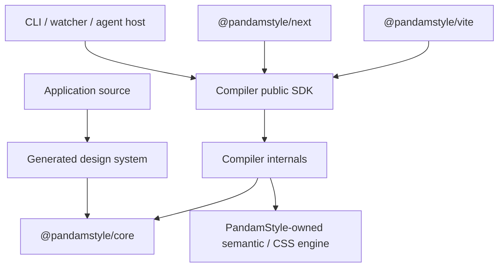

# Package architecture v1

Status: target candidate pending the canonical master plan, as explained in
[public API](public-api-v0.1.md). Runtime/compiler behavior is unchanged by
Phase 0.

## Public release boundaries (ARCH-01, ARCH-02)

Accept four packages: `@pandamstyle/core`, `@pandamstyle/compiler`,
`@pandamstyle/vite`, `@pandamstyle/next`. These are distinct browser-runtime,
build-service and host lifecycle/release boundaries. Internal domains are
directories, not packages. Next is a target package, not a present support
claim. CLI/config/ watcher SDK does not warrant another package; generated
vocabulary is a project artifact, not an npm meta-package.

| Package  | Purpose and exports                                                                                                                                                                                                                                                | Classification/importers                                                            | Allowed dependencies                                                                                                        | Forbidden dependencies/importers                                                                                                                  | Version responsibility                                                                                  |
| -------- | ------------------------------------------------------------------------------------------------------------------------------------------------------------------------------------------------------------------------------------------------------------------ | ----------------------------------------------------------------------------------- | --------------------------------------------------------------------------------------------------------------------------- | ------------------------------------------------------------------------------------------------------------------------------------------------- | ------------------------------------------------------------------------------------------------------- |
| core     | Compiled ref ABI, props, finite recipe selection/factory, theme refs, runtime selection error, public runtime types. Root exports ABI helpers `defineRecipeSelector`, `assertAbi`, types and `props`; create/token are generated sentinels, not core value exports | Browser-safe runtime; generated facade imports values, application may import types | No mandatory runtime dependencies initially; any future small browser utility requires explicit size/semantic justification | Compiler, fs/Node builtins, Babel, config/graphs/sessions, Vite, Next, React, donor packages. Build service must not be pulled into browser       | Owns ABI v1 implementation and runtime semver; changed conflict/selection semantics requires ABI review |
| compiler | createProjectSession, config/definition source API, diagnostics/protocols/types, CLI; advanced `/host` adapter bridge                                                                                                                                              | Node build-time; CLI, watcher, agents, adapters, design-system authors              | core for shared finite selection/ABI; parser/transformer, resolution, CSS-value/format tools, Node fs                       | Donor CSS-library packages, Vite/Next/framework runtimes; application browser/server component value imports; runtime transitive compiler imports | SDK, protocols and generated JS/metadata/declarations; private refactors do not change public contract  |
| vite     | `pandamstyle(options)` plugin entry backed by canonical service; types for options                                                                                                                                                                                 | Build-time; Vite configuration only                                                 | compiler public SDK dependency; Vite peer; its public host types                                                            | Core semantics implementation, compiler private paths, alternate graph/cache/publisher, donor packages; application modules                       | Adapter semver and declared supported Vite/SDK range; backend behavior verified per range               |
| next     | `withPandamStyle(options)` build-config integration, explicit backend option/capabilities and types                                                                                                                                                                | Build-time; Next configuration only                                                 | compiler public SDK dependency; Next peer; webpack public integration APIs where supported                                  | React runtime component API, private compiler paths, second semantics/cache/publisher, donor packages; app components                             | Separate tested webpack and Turbopack capability/range matrix; no implied parity                        |

Names follow responsibilities. `core` denotes browser ABI/composition and leaves
compile-time CSS authoring bound to generated vocabulary. `css` suggests a
generic raw CSS function absent from the contract; `dev` misclassifies
production runtime; `pstyle` adds no responsibility signal. Unscoped
`pandamstyle` would duplicate one of these boundaries or create an unnecessary
installer/meta-package: reject it.

## Target graph and forbidden edges



Application type-only imports from core do not add runtime edges. Definition
source imports compiler/config at build time. Adapters import only exported SDK
subpaths. Disallow core → compiler, Node filesystem, Babel, Vite, Next or React;
compiler → host adapters; app → compiler internals; adapter → private compiler
implementation. All final production dependencies, optional dependencies, peers,
bundled imports and generated import specifiers must contain zero `@stylexjs/*`
and zero `@pandacss/*`. Removing an npm dependency while bundling donor-named
imports is insufficient. Adapted engine behavior becomes owned internal source.

## One project authority (ARCH-18, ARCH-19)

CLI, Vite, Next, watcher and agent hosts consume one revision-based project
service. Multiple consumers share a service handle/coordinator for the same
project/output; an out-of-process transport may relay this exact SDK but owns no
semantic state. Separate output projects may use separate service instances.
Process-global module overlays/caches must become session-owned during
implementation, with independent session isolation tested; current globals are
not the target ownership boundary.

The service owns configuration/definition loading, binding resolution, positive
and negative dependencies, module and coverage graphs, design-system views,
validation, CSS state, diagnostics and transactional publisher. A host may cache
transport responses by complete immutable revision/artifact identity, but cannot
decide reuse validity, maintain semantic rule maps, resolve independent
vocabulary or publish an alternate truth. Invalidation reasons/full fallback
remain observable.

Compiler semantics and bundler semantics are distinct. Hosts own bundling,
chunking, module loading, HMR transport and framework lifecycle. They report
loaded module IDs and normalized source mutations through `/host`; the service
decides coverage and returns JS/CSS artifacts. Host-generated wrappers receive
explicit generated-role exemptions; they cannot grant consumer provenance.
Source digests and original identity must match the revision. A transformed
source or virtual module that lacks provenance requires an explicit SDK input
contract, otherwise fail with a coverage gap rather than silently skip it.

Vite becomes a thin service adapter. Its present rulesById/coverage/session
state is debt to migrate, not a model to copy. Dev updates deliver committed
generation artifacts; production bundling settlement may gate canonical commit
via a ticket. Failure after staging aborts the ticket; the previously committed
generation stays valid. Advanced HMR/coordinated whole-host output atomicity is
deferred, with compiler transaction safety mandatory. No promise of atomic
Vite/Next chunk directories is implied by PandamStyle generation publication.

Next webpack and Next Turbopack are separate backends. Backend option must be
explicit (`webpack` or `turbopack`); unsupported backend/version rejects before
compilation. Implementing webpack is not Turbopack support. Backend adapters
live inside next, consume the same service, and own only backend
hooks/transport. The large Next pilot is forbidden before standalone packaging
and the plan's earlier gates. No Next implementation or native frontend
commitment occurs here.

## Internal domains

Accept the candidate compiler domains, adding private observability and
separating config entry from API implementation:

```text
packages/compiler/src/
  api/                 # stable facade, config entry, advanced host bridge, CLI
  protocol/            # identities, diagnostics/result/audit schemas
  frontend/
    babel/             # source evaluation/transform/frontend adapter
    resolution/        # canonical module resolution and summaries
  semantics/
    provenance/        # identity-based proofs and escape checks
    conformance/       # role/channel/policy validation
  design-system/
    registry/
    tokens/
    themes/
    conditions/
    recipes/
    policy/
  engine/
    atomic/
    lowering/
    ordering/
  project/
    session/
    mutations/
    graph/
    css-state/
  artifacts/
    javascript/
    types/
    css/
    metadata/
    publication/
  hosts/
    watcher/           # journal input provider, not a second compiler
  observability/       # private counters/phase boundaries
```

Folders do not authorize independent releases. The frontend/engine can evolve
without changing author APIs; Rust/Oxc/SWC selection stays Phase 13 and
evidence-gated. Existing warm-path architecture must survive source relocation;
do not turn a structural migration into repeated cold/global rebuilds.

## Invariants and donor policy (ARCH-20)

| Invariant                      | Required contract                                                                                                           |
| ------------------------------ | --------------------------------------------------------------------------------------------------------------------------- |
| INV-01, INV-02, INV-19         | No permanent compatibility facade or donor CSS-library package in production graph                                          |
| INV-03, INV-04, INV-05, INV-15 | Useful behavior moves; donor source/historical scaffolding is deleted; Git is the archive; final tree is PandamStyle-owned  |
| INV-06                         | Required licenses, notices and origin/revision attribution survive in headers, ATTRIBUTIONS.md and LICENSES/                |
| INV-07, INV-08, INV-09, INV-17 | Independent semantic oracles plus fresh/incremental equivalence; no weakened/deleted failing test for migration convenience |
| INV-10, INV-11                 | One project service, no host-owned semantic truth/cache                                                                     |
| INV-12                         | Internal directories do not imply public packages                                                                           |
| INV-13                         | Standalone packaging gates large Next pilot                                                                                 |
| INV-14                         | Native selection requires measured evidence in Phase 13                                                                     |
| INV-16                         | Binding/provenance identity required; ambiguity fails closed                                                                |
| INV-18                         | Verified warm-path work/invalidation/publication behavior retained                                                          |
| INV-20                         | Each batch declares moved/deleted/temporary/final assets and remaining dependencies                                         |

Phase 5 deletes `packages/@stylexjs/`, `upstream/stylex/` and `upstream/panda/`
after useful behavior/tests are migrated and legal provenance is extracted.
Obsolete donor examples/tools are deleted, not archived. No `legacy/`,
`archive/`, `old-stylex/`, `reference-copy/`, `vendor-history/` or equivalent
donor source copy survives. Legal records are not executable donor architecture.
Existing historical evidence is evidence, not a compatibility surface. Any legal
question is resolved before deletion; no legal conclusion is inferred from
renaming.

Phase 0 batch disposition: moved none; deleted none; temporary candidate docs
pending canonical-plan reconciliation; final production state unchanged.
Subsequent batches must report transient donor edges until Phase 5 closes the
graph gate.
