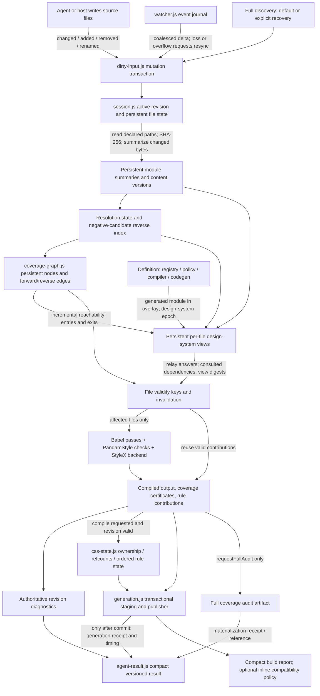

# PandamStyle strategic checkpoint — September 2026

**Decision: STOP general warm-path optimization.** Complete semantic and product
foundation work next. Start a separate cold/global profiling program before
choosing another compiler technology. Compiler speed and an agent-native
generation/validation/repair loop remain equal product goals.

PandamStyle has completed its first agent-first incremental architecture cycle.
Discovery, coverage maintenance, design-system views, affected-file compilation,
CSS rule maintenance, publication and diagnostics now have incremental paths.
This does **not** mean every default path uses them, every operation is
O(affected), or the foundation is production-ready. Named forwarding is
corrected on the tested semantic forwarding scope; types, SSR/hydration and browser cascade acceptance remain
open.

## 1. Authority, scope and how to read this record

| Identity                             | Value                                                        |
| ------------------------------------ | ------------------------------------------------------------ |
| Repository                           | `lbframe/pandam-style`                                       |
| Audited performance branch           | `perf/pandamstyle-spike-4-phase-d-incremental-graph-2026-09` |
| Checkpoint branch                    | `docs/pandamstyle-strategic-checkpoint-2026-09`              |
| Checkpoint base / final Phase D head | `562468bb088a88231e5171aaea4957391252ac77`                   |
| Phase D verification tested commit   | `cd2dbb2272392e11161f2048baa6f236cd55205a`                   |
| Phase D verification tested tree     | `0c4e4485be06a5842e350fef9dedfbcbf7a0ff3c`                   |
| Main, preserved                      | `71fcc045b18eb215f0c3a815bb8c8d15a9f99489`                   |

The tested commit and final Phase D head differ only in recorded evidence and
DEBT.md; compiler and verifier code do not differ. The checkpoint changes
documentation and derived evidence only. Its commit/tree are established by Git,
not embedded here with a self-referential hash. No PR, merge or publication is
part of this delivery.

Evidence labels used throughout:

- **Measured:** an existing latency, byte or counter observation, with workload
  and source. This checkpoint runs no performance campaign.
- **Verified:** executed historical tests/oracles within their stated scope.
- **Known defect:** behavior pinned by code and recorded debt; fresh equivalence
  does not establish its intended semantics.
- **Inference:** conclusion from inspected architecture, not a new experiment.
- **Recommendation:** next-work decision, not implemented behavior.
- **Aspiration:** proposed numerical target, not an approved release
  requirement.

This is the canonical post-spike synthesis. Historical reports remain immutable
records of their batches; draft specification proposals are requirements
context, not evidence of delivery. See [P0 scope][scope],
[acceptance][acceptance], [canonical status][status] and [consolidation
evidence][consolidation].

## 2. Canonical performance history

Corpus abbreviations below are exact: **c1000** = `c1000-t1000-r100-s809`;
**c10000** = `c10000-t1000-r100-s307`. They contain 1,000/10,000 components,
1,000 tokens and 100 recipes. Generated source manifests include extra files;
c10000's covered closure has 10,003 nodes and 10,002 compiled files. Corpus file
count, compiled-file count, graph-node count and artifact count are different.

All latency results use Node 22.22.0 on the recorded Linux/5800X3D machine.
Historical campaigns did not drop OS caches. **Cold process/cache-empty is not
cold OS cache.** `os_cold` is not_run. Medians with two or three observations
are measurements, not tail-latency guarantees. Phase D final campaign uses five
independent initialized-session observations per cell; initialization is outside
the warm transaction timer.

| Stage                                               | Corpus and exact scenario                                                               | Metric / boundary                                                                  | Observations per side                                                             | Process/session state                                          | Measured result                                                          | Evidence                                                                          |
| --------------------------------------------------- | --------------------------------------------------------------------------------------- | ---------------------------------------------------------------------------------- | --------------------------------------------------------------------------------- | -------------------------------------------------------------- | ------------------------------------------------------------------------ | --------------------------------------------------------------------------------- |
| Spike 1 baseline and opt-in work elimination        | c1000, `one_file_new_atom`                                                              | `filesystem_to_diagnostics_ms`, whole build-driver revision, including publication | 3 / 3                                                                             | `process_warm_edit`; full rebuild APIs                         | 3460.7 → 3348.9 ms                                                       | [S1][s1], campaign summaries                                                      |
| Spike 1 scale                                       | c10000, `one_file_new_atom`                                                             | Same metric                                                                        | 2 / 2                                                                             | `process_warm_edit`                                            | 32540.4 → 31881.4 ms                                                     | [S1][s1], c10000 summary                                                          |
| Original/pre-incremental comparator used by Spike 2 | c10000, `one_file_new_atom`, `babel_full`                                               | `filesystem_to_diagnostics_ms`, whole revision                                     | 2                                                                                 | `process_warm_edit`; recompiles project                        | **31558.0 ms (~31.6 s)**                                                 | [S2][s2], [S2 c10000 summary][s2summary]                                          |
| Spike 2 file-level session                          | c1000, `one_file_new_atom`, `babel_full` → `babel_incremental`                          | Same whole-revision metric                                                         | 3 / 3                                                                             | `process_warm_edit`                                            | **3287.8 → 307.6 ms**                                                    | [S2][s2]                                                                          |
| Spike 2 file-level session                          | c10000, same scenario and APIs                                                          | Same whole-revision metric                                                         | 2 / 2                                                                             | `process_warm_edit`                                            | **31558.0 → 4073.7 ms**                                                  | [S2][s2]                                                                          |
| Spike 2 structural reuse                            | c10000, same edit                                                                       | File counters, not elapsed time                                                    | 2                                                                                 | Warm initialized session                                       | 1 reparsed, 1 recompiled, 10001 reused; **4 actual parser calls**, not 1 | [S2][s2] §4                                                                       |
| Spike 3 publication + CSS                           | c10000, `one_file_new_atom`, `session_full_publish` → `session_incremental_publish_css` | `filesystem_to_diagnostics_ms`, whole revision                                     | 2 / 2                                                                             | `process_warm_edit`                                            | **3100.1 → 739.1 ms**                                                    | [S3][s3], [campaign][s3summary]                                                   |
| Spike 3 publication alone                           | c10000, same scenario, `session_incremental_publish`                                    | Same whole-revision metric                                                         | 2 / 2                                                                             | Warm session                                                   | 3100.1 → 935.6 ms                                                        | [S3][s3]                                                                          |
| Spike 3 CSS                                         | c10000, same edit, full aggregation → rule-state update                                 | CSS phase time; distinct from whole revision                                       | 2 / 2                                                                             | Warm session                                                   | **210.92 → 1.02 ms**                                                     | [S3][s3] §4.6                                                                     |
| Spike 3 artifact delta                              | c10000, same edit                                                                       | Written/reused artifact counts                                                     | 2 / 2                                                                             | Warm session publication                                       | **10006 → 2 written; 10004 reused**                                      | [S3][s3]                                                                          |
| Spike 4 A explicit mutation                         | c10000-class one declared file edit                                                     | Source read/hash counters; no latency claim                                        | Structural contract; no standalone c10000 Phase A campaign count established here | Warm full-discovery → verified-explicit input                  | **~10003 reads → 1 read + 1 hash**                                       | [dirty-input tests][dirtytests], S2/S4 corpus counters; Phase A commit `de8e4c7b` |
| Spike 4 C compact result                            | c10000, `one_file_existing_atoms#edit`, `compact_agent_result`                          | **`agent_edit_to_diagnostics_ms`**, validation only                                | **1** (c1000: 7)                                                                  | `process_warm_agent_loop`; initialized session                 | **173.12 ms**                                                            | [S4 C][s4], [index][s4index]                                                      |
| Spike 4 C report split                              | c10000, agent-loop publication variants, inline → reference audit policies              | Published `build-report.json` bytes                                                | 1 campaign observation per cell/policy                                            | Warm initialized session publication; byte metric, not latency | **5003195 → 3301 bytes** (~5 MB → ~3.3 KB)                               | [S4 index][s4index], [S4 C][s4]                                                   |
| Spike 4 C result size                               | c10000, `one_file_existing_atoms#edit`, compact success                                 | Serialized agent result bytes                                                      | 1                                                                                 | Warm initialized session                                       | **1815 bytes** (~1.8 KB)                                                 | [S4 index][s4index]                                                               |
| Spike 4 D style edit                                | c10000, `one_file_existing_atoms#edit`, compact                                         | `agent_edit_to_diagnostics_ms`                                                     | Baseline **3**, final **5**                                                       | `process_warm_agent_loop`                                      | **175.88 → 57.48 ms**                                                    | [baseline][dbase], [final campaign][dcampaign]                                    |
| Spike 4 D import change                             | c10000, `import_change#import`, compact                                                 | Same validation-only KPI                                                           | 3 / 5                                                                             | Warm initialized session                                       | **132.21 → 21.86 ms**                                                    | [baseline][dbase], [final campaign][dcampaign]                                    |
| Spike 4 D re-export change                          | c10000, `reexport_change#reexport`, compact                                             | Same KPI; inherited forwarding semantics                                           | 3 / 5                                                                             | Warm initialized session                                       | **506.94 → 97.61 ms**                                                    | [baseline][dbase], [final campaign][dcampaign]                                    |
| Spike 4 D unresolved import repaired                | c10000, `unresolved_import_then_file_appears#appears`                                   | Same KPI                                                                           | 3 / 5                                                                             | Warm initialized session                                       | **187.56 → 70.16 ms**                                                    | [extra baseline][dextra], [final campaign][dcampaign]                             |
| Spike 4 D declared no-change                        | c10000, `no_change#declared_unchanged`                                                  | Same KPI; declared file with identical bytes                                       | 3 / 5                                                                             | Warm session; **still 1 read/hash**                            | **160.15 → 57.80 ms**                                                    | [extra baseline][dextra], [final campaign][dcampaign]                             |
| Spike 4 D closure structure                         | c10000, style edit / declared no-change                                                 | `counter:closure_nodes_examined`                                                   | 5 each                                                                            | Warm initialized session                                       | **1 / 10003 nodes; no-change 0 nodes**                                   | [final campaign][dcampaign]                                                       |
| Spike 4 D publication                               | c10000, existing-atoms edit, `compact_agent_result_plus_compact_publish_metadata`       | **`agent_edit_to_generation_committed_ms`**                                        | **2**                                                                             | Warm initialized session, incremental publication              | **792.73 ms**; diagnostics in this run 74.32 ms                          | [publish run][dpublish]                                                           |
| Spike 4 D global definition edit                    | c10000, `token_value_full_fallback#definition`, compact                                 | `agent_edit_to_diagnostics_ms`; **global analysis**, no publication                | **5**                                                                             | Warm process, **full semantic fallback**                       | **24695.78 ms (~24.7 s)**                                                | [final campaign][dcampaign]                                                       |

**What ~31.6 s means:** it is Spike 2's same-tree full-rebuild comparator, not
Spike 1's original 32540.4 ms observation, not process launch time and not a
cold-session benchmark. Spike 3's 3100.1 ms baseline is a new campaign of the
Spike 2 publication strategy; it is not the earlier 4073.7 ms run. Its headline
is the whole revision, **not 3100 ms spent exclusively inside publication**.

The build-driver's historical metric name includes publication because of where
that driver records completion. The agent KPI stops at authoritative validation;
it excludes CSS/publication and audit. Thus **31.6 s → 57 ms is at most an
illustrative same-class local-edit trajectory across different scenarios and
completion boundaries, not a uniform 550× compiler speedup**.

The separate `report-bytes.js` audit has a different artifact shape: **3252376 →
2572 bytes**, one build per policy ([inline audit][bytesinline], [reference
audit][bytes]). Its compact coverage accounting is not the 5003195 → 3301
campaign pair. Both are preserved; neither replaces the other.

Phase D also retained a separate three-observation diagnostics run: style 54.35,
import 19.46 and re-export 101.55 ms. The five-observation campaign above is the
checkpoint's canonical final comparison; the earlier run is not silently merged
into it. Derived values, counts and provenance are frozen in [checkpoint audit
facts][facts]. JSONL cell `wallClockMs` includes child/session setup and is not
the agent edit KPI.

## 3. What was actually built

### Foundation and compiler path

This is a **StyleX fork**, with selected Panda-derived mechanisms integrated
into the fork: token dictionary/graph/category policy, restricted condition
definitions, theme projections, and recipe selection/defaults. It is not a
second Panda CSS emitter. Registry/manifest/codegen and category/provenance
enforcement feed the fork's StyleX atomic, variable, theme and composition
machinery. Donor attribution is recorded in [architecture
specification][archspec] and module headers, including Panda recipe donor
`1a310482`.

[compileFile][build] performs Babel pass 1 over original JS/TS/JSX using
PandamStyle's plugin, then emits intermediate text and Babel pass 2 strips TS
and lowers JSX. Binding-aware policy and provenance checks rely on Babel scopes,
paths and bindings. A module-summary parse supports coverage/resolution. These
are separate jobs; historical counts must not be confused with file counts.
StyleX atomic lowering is called from [compiler.js][compiler].

`buildProject` remains a fresh full-build path and oracle reference.
`createProjectSession` stores project state **in memory**, not a disk-resumable
compiler daemon or query database. `initialize`, `applyChanges` /
`applyAgentChanges`, `validate`, `compile` and `close` expose its lifecycle. The
session is synchronous and single-writer. A new unpublished revision supersedes
the preceding prepared revision; committed generations stay immutable.

### Runtime data flow



The optional audit can be requested before publication (included in staging) or
after publication (written beside the generation). Invalid revisions can return
diagnostics and request audit without publishing. The diagram shows the session
pipeline; the Vite adapter has its own bundler hooks and publishes on output
success, not on merely finishing analysis.

### State and authority boundaries

| Actual mechanism                       | Owner / behavior                                                                                                                                               | Evidence and limitation                                                                                                                     |
| -------------------------------------- | -------------------------------------------------------------------------------------------------------------------------------------------------------------- | ------------------------------------------------------------------------------------------------------------------------------------------- |
| Explicit mutation transactions         | [dirty-input.js][dirty], [session.js][session]; changed/added/removed/rename pairs; modes are verified-explicit, watcher and full-discovery                    | Host supplies complete mutations after writes; hashing verifies declared bytes, **not completeness of undeclared edits**                    |
| Watcher mutation provider              | [watcher.js][watcher]; journal coalescing, output ownership exclusions, event-loss/overflow resync                                                             | [watcher tests][watchertests]; loss causes full discovery                                                                                   |
| Full-discovery fallback                | Session default; initialization, requested recovery, periodic audit and untrusted journal                                                                      | Correctness escape route has O(project) costs; explicit counters distinguish discovery from semantic full fallback                          |
| Content hashing and module summaries   | SHA-256 source hash; summaries separate syntax facts from edge resolution                                                                                      | Summary reuse is persistent within a session; unchanged bytes avoid summary parse                                                           |
| Resolution state                       | Per-request candidate probing, edge resolutions, first-hop lookup                                                                                              | Add/remove/rename re-probe affected keys; negative resolution indexed by candidate paths, so file appearance can repair it                  |
| Persistent coverage graph              | [coverage-graph.js][coverage]; nodes, roots, forward/reverse edges, origin, unresolved/external/relay records                                                  | Incremental reachability and deterministic ordering; [closure tests][closuretests] include cycles, pruning and recovery                     |
| Persistent DSVs and relay dependencies | Session DSV epochs, module versions, views, `dsConsumers`, `dsImportConsumers`, consulted relay-answer dependencies                                            | Null relay answers retain dependencies for break/repair; resolved first hop + depth keys deduplicate walks; forwarding P0 subsequently resolved on tested scope |
| File validity                          | Source hash, role, compiler contract, semantic epoch, engine-options digest, CSS layers, runtime module, resolution digest, DSV digest                         | Valid contributions reused; config/definition mutation can invalidate globally                                                              |
| Incremental CSS                        | [css-state.js][css]; rule identity, ordered keys, per-file ownership/refcounts; design-system contributions                                                    | Last owner removal deletes rule; local contribution updates avoid re-aggregation; final CSS text still materializes                         |
| Incremental publication                | [generation.js][generation]; output digests and ownership, staging reused outputs, hard-link capability/copy fallback, pending state, commit/rollback/recovery | **Delta writes do not eliminate O(total) link/unlink work**; immutable directory generations still materialize a complete output tree       |
| Agent result and audit                 | [agent-result.js][agent]; result v1, build report v2/reference or v1/inline, coverage report v1, capped candidates and affected entries with totals/truncation | `candidateTokens` pages deeper vocabulary; `requestFullAudit` is current-revision only; snapshots must be refreshed after commit            |
| Verification/evidence                  | [verify-pms.sh][verify], per-kind step contracts, process logs, counts, environment and artifact digests; independent fresh-build oracles                      | Delivery gate is selected package suites, not an assertion that every root-level suite passes                                               |

**Availability is not default adoption.** Session publication still defaults to
`session_full_publish`; incremental CSS requires
`publishVariant: 'session_incremental_publish_css'`. Audit defaults to
`reference`. No supplied mutation defaults to full discovery. Fast agent
measurements drive `applyAgentChanges` with compact results. Do not claim a
plain CLI/Vite call automatically inherits those measurements.

## 4. Two equal performance programs

### Program A — warm AI-agent loop

Primary KPI: **`agent_edit_to_diagnostics_ms`**, starting at accepted mutation,
ending at the complete authoritative revision verdict. Secondary KPI:
**`agent_edit_to_generation_committed_ms`**, when publication is requested.
Target: persistent sessions, small local and multi-file writes, invalid→repair,
import/relay changes and module add/remove/rename. Host write time and transport
are separate end-to-end integration costs, not currently inside this KPI.

Final c10000 compact campaign (n=5 per scenario, warm initialized sessions):
five-file diagnostics **66.62 ms**, twenty-file **110.86 ms**, forbidden-value
**59.18 ms**, repair **49.72 ms**, add **97.80 ms**, remove **85.91 ms**, rename
**93.22 ms**. Source: [D campaign][dcampaign]. These support “several local
scenarios in tens of milliseconds to <100 ms”; they do not support “all edits
under 100 ms” or a p95 SLA. The re-export scenario inherits the semantic debt.

Remaining measured cost, same campaign's existing-atoms edit, n=5:

| Phase                         | Median ms | Interpretation                                             |
| ----------------------------- | --------: | ---------------------------------------------------------- |
| Diagnostics overall           |    57.484 | Observed feedback latency                                  |
| `session_scan_ms`             |     2.433 | Declared discovery still builds some known-file structures |
| `session_closure_ms`          |     0.724 | Incremental graph maintenance                              |
| `session_compile_files_ms`    |    46.737 | Broad loop, including output/rule/coverage bookkeeping     |
| `session_compile_affected_ms` |     4.877 | Actual affected-file region, nested in compile-files       |
| `session_reuse_iteration_ms`  |     4.728 | Retained O(total) reuse pass                               |
| `session_coverage_entries_ms` |     6.141 | Retained entry materialization                             |
| `unaccounted_diagnostics_ms`  |     6.432 | Harness residue, not an identified optimization            |

DSV recomputations are zero on this style edit; counters prove the structural
result. Independent medians and nested phases **must not be added as an exact
partition**. Compile-files has substantial bookkeeping beyond the named
subtimers; a new profile would be needed before assigning that residue to Babel.

Declared no-change is **not** zero compiler work: final campaign n=5 reports one
file recompiled and two Babel parser calls, with zero changed bytes and zero
graph nodes examined. The explicit scanner invalidates every declared path even
when its hash matches. This is avoidable warm performance debt, not semantic
incorrectness, and is not material enough to reopen optimization now. An empty
transaction is a different control and must be measured separately.

Publication remains materially slower: n=2 warm c10000 publish run, existing
atoms **792.73 ms**, new atom **751.57 ms**, five-file **758.37 ms**,
twenty-file **831.41 ms**, repaired valid revision **734.98 ms**. Invalid
revisions have no committed-generation timing. [D publish][dpublish] retains
complete-generation materialization/retirement and metadata costs; no evidence
makes those validation blockers. Measure real hosts' publish frequency before
optimizing them.

### Program B — cold / global compiler

Workloads: first project build, CI, first session initialization, cold compiler
process start, full-discovery recovery and global definition mutation. A global
definition edit runs in a warm process but belongs to this program because it
invalidates the semantic epoch and recompiles the project.

Historical Spike 2 c10000 `process_cold_cache_empty` `one_file_new_atom`: full
API **29977.99 ms**, incremental driver including first initialization
**29573.54 ms**, n=2 each, warm OS cache ([S2 summary][s2summary]). Those are
historical whole-driver timings, not a newly measured Phase D
`session_initialize_ms`. Latest global definition diagnostics are **24695.78
ms**, n=5, and the extra-baseline observation was **25188.13 ms**, n=3. [D
sources][dextra] [and final][dcampaign].

Required cold KPIs: `cold_build_ms`, `session_initialize_ms`,
`global_design_change_ms`, `peak_rss`, actual parser-only `parse_ms`, Babel
traversal/transform time, PandamStyle policy time, StyleX backend time,
design-system generation, coverage/DSV construction, CSS aggregation,
publication and metadata. Distinguish global **diagnostics** from global
**committed publication**. No current Phase D cold CPU profile proves their
present shares. Warm success does not close the fast-compiler goal.

For future measurements, `session_initialize_ms` includes construction,
`initialize()` **and first `validate()`** through a usable verdict.
`initialize()` itself prepares/scans the revision; compilation and graph
analysis occur during validation. Timing only that method would omit the main
cost.

## 5. Semantic debt — P0 forwarding correctness

**RESOLVED on the tested scope in the semantic forwarding batch:** the inherited
named/renamed forwarding P0 is corrected. [DEBT.md][debt] preserves the defect
history; the [named-list test][dsvtests] is converted to require correct
invalidation. See [the forwarding contract](forwarding-semantics-2026-09.md) and
the independent semantic matrix in `evidence/forwarding-semantics-2026-09/` for
fresh and persistent incremental expectations. Remaining semantic/product P0s
include generated types, browser cascade, SSR/hydration and agent protocol
qualification. This does not assert complete ECMAScript cyclic module support.

The following mechanism and observation table describe the **historical Phase D
defect**, superseded by the semantic contract above; performance history remains
unchanged.

`collectReexports` emits named/namespace specifiers and a separate source
marker. Specifiers have no request field. `walkToDesignSystem` groups **only
source markers**. Consequently the named and namespace branches of the group's
remapping loop cannot run. For

```js
export { create, token, props } from './design';
```

`exportsOfRelay` is `[]` instead of the three exported→original mappings.
`readModuleFacts` then uses `relay.get(exported) ?? exported`: unchanged names
are recognized by their spelling anyway, even when a name was removed from the
relay. The DSV digest never represented that list, so list edits do not
invalidate the affected consumer's semantics. An independent bundler might
reject the missing JS export later; that is not authoritative compiler
rejection.

| Form                                      | Exact supported observation / current limitation                                                                                         | Expected behavior                                                                                                      |
| ----------------------------------------- | ---------------------------------------------------------------------------------------------------------------------------------------- | ---------------------------------------------------------------------------------------------------------------------- |
| Direct named import                       | Works for tested helpers; bypasses faulty relay map                                                                                      | Resolve actual DS export and bind original helper                                                                      |
| Direct import alias, e.g. `token as t`    | Works: local Babel binding maps to imported `token`; valid fixture/tests                                                                 | Preserve binding and shadowing protection                                                                              |
| Direct namespace import, `import * as ds` | Tested valid fixture recognizes member accesses                                                                                          | Only actual exported helpers gain provenance                                                                           |
| Single-hop `export * from`                | Map populated from `found.exports`; DSV/test coverage works for tested names                                                             | Forward legal JS export set, respecting conflicts/default rules                                                        |
| Named list without aliases                | Empty map; same-spelling fallback can falsely recognize omitted names                                                                    | Only listed names recognized; removal revokes recognition and revalidates consumers                                    |
| Named re-export alias, `create as make`   | Alias mapping discarded; `make` is treated as original name `make`, not `create`                                                         | Map public alias to original semantic helper across hops                                                               |
| `export * as ds from`                     | Coverage follows the edge, but namespace specifier discarded; consumer `import { ds }` classified as `exportName: 'ds'`, not a namespace | `ds.create` / `ds.token` resolve through the namespace forwarding relation                                             |
| Multi-hop / multiple sources              | Walk returns first found DS; star uses target `exports` rather than composing `exportsOfRelay`                                           | Compose export mappings with correct source, conflicts, cycles and shadowing semantics within declared supported scope |

The namespace test asserts `ok` and a non-null view digest. It does **not**
assert that `everything.create` was lowered or that consuming the result
succeeds. Thus “namespace exports work” is unproven; source inspection
establishes a related forwarding gap. “Only named lists are wrong” is too
narrow. Single-hop star support is not a certification of every nested ESM
export combination.

Affected features: `create`, `token`, `props`, `recipes`, `themes`, helper
provenance/authority, derived views, coverage claims and alias/barrel use. Risk:
valid-looking diagnostics can precede wrong or untransformed output, or a
removed export remains trusted. Fresh and incremental computations share the
defect: **equivalent wrong answers are still wrong**. Phase D's 19/19 traces per
c100 and c1000 prove reuse equivalence, not forwarding correctness.

**Repair scope recommendation:** preserve source ownership of each specifier,
compose real relay export maps, represent namespaces distinctly, constrain
helper recognition to actual exports, propagate changed view digests to
consumers. Do not merely attach request fields to the existing namespace branch:
flattening a namespace into all top-level helpers would still violate its
semantics. Bound the supported multi-source/conflict/cycle cases or reject
unsupported forms explicitly. Invert the deliberate named-list limitation test,
with a recorded semantic baseline change rather than silently rewriting
historical evidence.

Required regression matrix:

| Axis           | Required cases and assertions                                                                                                                                                                                                         |
| -------------- | ------------------------------------------------------------------------------------------------------------------------------------------------------------------------------------------------------------------------------------- |
| Export forms   | Direct, named identity, named alias, star, namespace, star→named, named→star; empty list and omitted helper                                                                                                                           |
| Chaining       | One/two/three hops, multiple sources, colliding exports, explicit override of star, cycles, depth limit, unrelated relay                                                                                                              |
| Helper domains | create/token/props/recipes/themes; public/private token policy and binding shadowing                                                                                                                                                  |
| Revisions      | Add/remove/rename exported name; remove/restore relay; relay stops/restarts reaching DS; invalid→repair; multiple edits in one transaction                                                                                            |
| Paths          | JS/TS/TSX, fresh build and warm explicit/watcher sessions, packed Vite pilot                                                                                                                                                          |
| Evidence       | Intended success/rejection **before** equivalence gate; exact structured diagnostics; DSV changes and affected consumers; CSS/JS digests; transform assertion and runnable output; unrelated consumers reused; no invalid publication |

## 6. Verification and tooling debt

Historical [native summary][summary] establishes **`complete: true`**, verdict
**`verified`**, clean starting tree at the supplied tested commit/tree. Seven
steps ran, none failed/skipped. Counts: **1566 passed**, **64 skipped**; **66
passed suites**, **1 skipped suite**, zero failed.

| Step                  | Kind / historical evidence contract                                |          Recorded tests |
| --------------------- | ------------------------------------------------------------------ | ----------------------: |
| install               | command: ran, exit zero; counts null                               |                       — |
| build                 | command: ran, exit zero; counts null                               |                       — |
| upstream-babel-plugin | test: exit and Jest suite/test accounting agree                    | 1007 passed, 64 skipped |
| upstream-stylex       | test: same integrity contract                                      |               99 passed |
| pandamstyle           | test: same integrity contract, dedicated package surface           |              460 passed |
| pilot                 | real packed application build, exit zero; counts null              |                       — |
| artifacts             | artifact-check: exit zero and digest artifact present; counts null |                       — |

[step-contracts.js][steps] repaired an impossible success condition: demanding
Jest counts from install/build/pilot/artifacts could never yield completeness.
Passed process, verified evidence and complete run are now separate concepts.
Unknown steps fail classification. Skips remain incomplete. Logs whose failure
counts contradict zero exit cannot yield verified success.

**Resolved P0 verification reliability gap:** the official gate now has eight
required steps, in order: install, build, upstream-babel-plugin, upstream-stylex,
pandamstyle, **tooling-tests**, pilot, artifacts. Tooling runs after the compiler
tests and before pilot/artifact qualification, using the root Jest configuration.
It is explicitly `kind: test`, with the same test/suite count-integrity contract.
The separate tooling subtotal contributes to global totals without changing the
PandamStyle compiler subtotal. [Dedicated evidence][toolingverification] records
the tested commit/tree, exact final summary and command environment.

`node tools/pms/run-tooling-tests.js <run-directory>` derives the intended
`tools/pms/__tests__/**/*-test.js` inventory from disk, compares it with Jest's
JSON discovery and execution results, and runs the equivalent of
`node_modules/.bin/jest --runInBand --ci tools/pms/__tests__`. Empty or incomplete
suite selection fails; Git's tracked inventory also prevents a missing source
suite from silently reducing coverage. Missing count lines/totals, failed or unaccounted
tests/suites, nonzero commands, omitted/skipped required steps and unknown step
classification cannot produce `complete: true`. Regression fixtures exercise
the actual runner's summary and final verdict, including a green eight-step run.
This contract extends the historical seven-step gate; historical summaries and
their 460 PandamStyle / 1566 combined baselines remain unchanged in their evidence.

These checks belong exclusively to repository development, qualification and
CI/release verification. Normal AI-agent compiler sessions, including
`session.applyAgentChanges()`, do not invoke Jest, tooling tests or this verifier.
No compiler or agent runtime behavior changes accompany this gate extension.

Package install/build remain non-test steps. A
runner claiming verification is not proof that all P0 acceptance cases ran.
Root-wide pre-existing failures recorded in [S4][s4] are also not erased by the
green selected delivery gate.

## 7. Product gap and priority matrix

P0 = required before calling the **declared foundation** production-ready. P1 =
required for the broader design-system product. P2 = useful, nonblocking.
Research = architecture undecided. “Partial” means an implementation or narrower
proof exists, with acceptance still open; “absent” means absent in the delivered
PandamStyle surface, not absent in vendored donors. Priorities below are
recommendations; optional broader integration is not promoted to P0 by interest.

| Item                                          | Status / evidence                                                                                                          | Risk or missing proof                                                                                                                 | Dependency                                                        | Recommended priority                                                                                     |
| --------------------------------------------- | -------------------------------------------------------------------------------------------------------------------------- | ------------------------------------------------------------------------------------------------------------------------------------- | ----------------------------------------------------------------- | -------------------------------------------------------------------------------------------------------- |
| Generated TypeScript types                    | **Absent**; [package][package] explicitly declares no types export; [status][status]                                       | TS users lack generated closed vocabulary; projections can disagree                                                                   | Canonical registry/public export semantics, transactional codegen | **P0**                                                                                                   |
| SSR correctness                               | **Partial foundation, acceptance absent**; static CSS/runtime exist; SSR not_run in [consolidation][consolidation]         | Missing CSS before first paint or server/client identity drift                                                                        | Correct exports, stable registry IDs, packed integration          | **P0** for specified server/client foundation                                                            |
| Hydration correctness                         | **Absent acceptance**; no hydration proof                                                                                  | Class/variable mismatch, runtime injection on first render                                                                            | SSR fixture, client entry, theme/recipe selection                 | **P0**                                                                                                   |
| Browser cascade proof                         | **Absent**; CSS differential/snapshots are narrower than [acceptance][acceptance] AC-024–042                               | Correct-looking text with wrong computed style under conditions/composition                                                           | Stable output, browser fixture, pinned environment                | **P0**                                                                                                   |
| Named re-export semantics                     | **Resolved on tested scope**; named/alias/local/star/namespace/multi-hop oracle and binding tests                            | General cyclic/external-star forwarding remains fail-closed; see forwarding contract                                                   | Module export map and binding semantics                           | **Resolved semantic P0**                                                                                 |
| Diagnostic machine contract completeness      | **Partial**; result/diagnostic versions, repair fields, caps, file context in [agent][agent] and tests                     | Nullable locations; not every error is mechanically repairable; syntax/internal failure paths and session identity need qualification | Correct semantic rejection, code catalogue, integration schemas   | **P0** core protocol qualification; richer repair suggestions **P1**                                     |
| Token/category typing                         | Runtime/category enforcement **demonstrated**; generated static typing **absent**                                          | Typed editor contract missing; privacy/category suggestions must match consumer vocabulary                                            | Types generator over registry                                     | **P0**                                                                                                   |
| Recipes                                       | Restricted base/finite variants/defaults **implemented and tested**; [recipe.js][recipe], recipe contract tests            | Browser conflict parity and generated signatures incomplete                                                                           | Types + cascade proof                                             | **P0** retained subset; not all Panda recipe APIs                                                        |
| Slot recipes                                  | **Intentionally deferred**, not delivered                                                                                  | No multi-part component contract                                                                                                      | Recipe/type/composition foundation                                | **P1**                                                                                                   |
| Compound variants                             | **Intentionally deferred**, registry rejects `compoundVariants`                                                            | Precedence and bounded branch/runtime design needed                                                                                   | Recipes + browser composition proof                               | **P1**                                                                                                   |
| Layout/pattern primitives                     | **Absent/deferred** in PMS public surface                                                                                  | Layout authoring ergonomics missing; policy must stay closed                                                                          | Category policy + generated types                                 | **P1**                                                                                                   |
| Vite integration                              | **Partial demonstrated**; packed React pilot, rollback and output-hook tests, [vite.js][vite]                              | SSR/hydration/advanced HMR not certified; `build.write:false` explicitly refused                                                      | Semantic/types/browser foundation                                 | **P0** selected pilot; advanced HMR **P1**                                                               |
| Rolldown integration                          | **Absent dedicated qualification**; no explicit PMS export/pilot                                                           | Plugin ordering, resolution, AST and output lifecycles may differ                                                                     | Cold profile + integration contract                               | **Research**; eventual wider adapter **P1**                                                              |
| Server/build integration                      | CLI/buildProject and packed build **demonstrated**; server/TanStack Start acceptance open                                  | Build success is not server deployment correctness                                                                                    | SSR/hydration qualification                                       | **P0** selected Node SSR path; TanStack-specific integration **P1**                                      |
| Source maps                                   | **Absent PMS compileFile mapping contract**; returns code+metadata, no composed map; maps disabled in performance evidence | Debugging transformed TS/JSX cannot reliably map to source                                                                            | Two-pass map composition + bundler mapping                        | **P1**; diagnostics original-source positions remain **P0**                                              |
| Production minification                       | Bundler pilot builds production output; **PMS-specific acceptance partial**, no owned minifier contract                    | CSS order/class/runtime selection under minification unqualified                                                                      | Browser/packed integration tests                                  | **P0** prove existing production path; native minifier **P2**                                            |
| Code splitting                                | **Partial boundary**; coverage observes local dynamic edges; no chunk-specific CSS proof                                   | Missing CSS or changed order when lazy chunk loads                                                                                    | Coverage + browser/bundler fixture                                | **P1** optimization; **P0** loaded CSS correctness for declared supported cases                          |
| CSS layer behavior                            | Option and shared StyleX emission **implemented**, `useCSSLayers` in validity keys                                         | Layer ordering/external-layer interactions not browser-proven                                                                         | Browser cascade fixture                                           | **P0** validate advertised option; richer layer configuration **P2**                                     |
| Theme behavior                                | Registry overrides/StyleX variables/theme classes **implemented**, code/oracle tests                                       | Actual nested scope, media preference distinction, SSR parity unproved                                                                | Browser + SSR matrix                                              | **P0** retained theme subset                                                                             |
| Multi-entry builds                            | Multiple roots/closed coverage **implemented**; complete independent bundler-output proof **partial**                      | Generation isolation and CSS union/order across entries unknown                                                                       | Packed build/SSR and publisher ownership                          | **P1** broader multiple-output support; **P0** declared-root correctness                                 |
| Incremental recovery after process restart    | Publication pending-state/crash reconciliation **implemented**; session graph/compile memo reload **absent**               | Restart pays cold rebuild; no persistent warm guarantee                                                                               | Versioned durable cache design only if measured need              | **P0** no mixed/false current generation, targeted restart proof; warm cache persistence **P2/Research** |
| Exact host revision and mutation completeness | Session revision binding **implemented**; cross-process identity/undeclared-writer protocol **partial**                    | Same local revisionId after restart; unreported external edits                                                                        | Host session epoch, write transaction discipline, resync          | **P0** agent integration contract                                                                        |
| Verification tooling inclusion                | **Resolved**: independent required `tooling-tests` step                                                                     | Selected eight-step gate includes its own tooling tests; broader P0 qualification remains scoped                                      | Separate tooling inventory, count integrity and real runner fixtures | **P0** evidence trust                                                                                  |

No production-readiness claim is warranted by “460 tests passed,” by a
successful Vite build, by fresh-rebuild equality, or by completing four
performance spikes. The canonical [PANDAMSTYLE.md][status] correctly says P0 is
not validated. Its 111-test native reference and 173 ms headline are historical
examples, not the latest Phase D baseline. Earlier specification statements “to
implement” are draft-era context; use this checkpoint for current delivery
state.

## 8. Agent-native contract and implementation audit

| ID       | Required invariant                                                                         | Current audit / evidence                                                                                                                                                                                   |
| -------- | ------------------------------------------------------------------------------------------ | ---------------------------------------------------------------------------------------------------------------------------------------------------------------------------------------------------------- |
| AGENT-01 | Agent declares exactly changed/added/removed/renamed paths                                 | **Implemented**, explicit transactions and [dirty tests][dirtytests]; complete-set guarantee depends on host                                                                                               |
| AGENT-02 | Complete diagnostics bound to exact active revision                                        | **Verified within session**; revisionId/semantic epoch, stale revision requests rejected; cross-process host identity incomplete                                                                           |
| AGENT-03 | Structured fields are authoritative; prose is explanatory                                  | **Implemented**, diagnostic v1 + machine fields/repair kind/candidates/context; nullable fields and nonrepairable results explicit; qualification remains P0                                               |
| AGENT-04 | Invalid revisions require no publication                                                   | **Verified**, validate/result independent of compile; invalid compile cannot claim success                                                                                                                 |
| AGENT-05 | Full audit not required for local feedback                                                 | **Verified**, reference policy, lazy `requestFullAudit`; inline compatibility is optional                                                                                                                  |
| AGENT-06 | Local expensive work scales with affected region                                           | **Partial but structurally achieved for discovery/graphs/compile/CSS delta**; reuse/coverage lists and immutable publication retain O(total) work; no blanket complexity promise                           |
| AGENT-07 | Fallbacks machine-observable                                                               | **Implemented**, discovery versus semantic fallback, reasons/counters; host must preserve them in transport                                                                                                |
| AGENT-08 | Publication never claimed before actual commit                                             | **Verified within tested publisher paths**; receipt/id/timing only after commit; snapshots refreshed on request                                                                                            |
| AGENT-09 | Warm result equivalent to fresh rebuild, and intended semantics correct                    | **Fresh equivalence verified on tested scope** (Phase D 19 traces at c100/c1000); intended forwarding **fails**. Separate intended-behavior assertions required                                            |
| AGENT-10 | Agent deterministically requests detail without whole project by default                   | **Implemented**, paged `candidateTokens`, explicit full audit, total/truncation fields; old superseded revision audit is not retained                                                                      |
| AGENT-11 | Host supplies complete mutation set and excludes concurrent undeclared writers, or resyncs | **Contract required**; verified-explicit does not discover omissions. `verifyMutationSet` checks undeclared additions/removals, not all hidden content edits; periodic/forced full discovery rereads bytes |
| AGENT-12 | Results from different sessions/restarts cannot be confused                                | **Host contract incomplete**; scope revisionId by host session epoch/instance and source transaction; local ids alone reset                                                                                |
| AGENT-13 | Cancellation/supersession, request readiness and truncation are explicit                   | **Implemented locally**, superseded revision handling, audit requested vs materialized, caps; host concurrency/transport needs acceptance tests                                                            |
| AGENT-14 | Failure preserves last valid publication and repair uses current bytes                     | **Verified in rollback/incremental tests**, crash reconciliation exists; selected integration must also prove restart and downstream failure cases                                                         |

Agent-native does not promise automated aesthetic token choice. A substitution
candidate is an admissible option, not a proof that 17px→16px preserves intent.
Autofix remains null. A thin host protocol must carry session identity, mutation
transaction, revision, fallback flags and publication receipt without parsing
prose. No MCP server is required to finish this foundation.

**Inspected diagnostic completeness gap:** `validate` turns exceptions without a
`diagnostics` array into `PMS_SESSION_INTERNAL`, phase `session`, rule
`session.internal`, null file/line/column and context containing only
revisionId. An ordinary Babel syntax exception can therefore take the same
machine path as a compiler defect, with source detail surviving only in prose.
That is inadequate for the invalid-generation repair contract. Batch 3 must
distinguish source syntax failure from internal failure and retain structured
original-source location; this checkpoint does not change the error semantics.
Candidate and affected-entry caps are implemented, but the diagnostics array
itself is not paged: success-case 1815 bytes is not a bound on a many-error
response.

## 9. Fast-compiler contract and targets

No universal numerical performance budget was approved in the repository's P0
specification. Keep structural correctness requirements separate from proposed
latency goals. The following numbers are **aspirations**, deliberately not
retroactive gates on historical runs; requirement/unknown status is explicit.

| Category                     | Current measured state (boundary / source / count)                                                    | Desired target                                                                                                                           | Target status                                                                                 |
| ---------------------------- | ----------------------------------------------------------------------------------------------------- | ---------------------------------------------------------------------------------------------------------------------------------------- | --------------------------------------------------------------------------------------------- |
| Cold build                   | Historical S2 c10000 full-driver 29977.99 ms, cold process, warm OS, n=2                              | Establish Phase D phase/memory baseline first; no chosen ms threshold                                                                    | **Unknown** numerical; reproducible measurement **requirement**                               |
| First session initialization | Historical S2 incremental cold-driver 29573.54 ms, n=2; isolated initialize time not established here | Measure isolated initialization and launch/load separately                                                                               | **Unknown** numerical                                                                         |
| Warm local edit              | D existing atoms diagnostics 57.48 ms, n=5, c10000                                                    | ≤100 ms p95 on pinned c10000 local valid/invalid/repair matrix                                                                           | **Aspiration**, p95 not qualified by five samples                                             |
| Warm multi-file edit         | D five 66.62 / twenty 110.86 ms diagnostics, n=5                                                      | ≤200 ms p95 for declared twenty-file transaction on same corpus                                                                          | **Aspiration**                                                                                |
| Global design mutation       | D c10000 definition diagnostics 24695.78 ms, n=5, warm process/global fallback                        | Choose budget after cold profile and expected global-edit frequency                                                                      | **Unknown** numerical; correctness after global changes **requirement**                       |
| No-change transaction        | D declared-identical file 57.80 ms, n=5, 1 read/hash, 0 graph nodes, **1 recompile / 2 parser calls** | Retain zero graph re-examination; eventually avoid needless recompile for identical declared bytes; measure empty transaction separately | Graph structural **requirement**; zero-recompile **aspiration currently unmet**, no ms target |
| Incremental publication      | D committed existing atoms 792.73 ms, n=2; diagnostics 74.32 ms in that run                           | ≤1 s p95 committed generation on pinned local-edit corpus if host publishes every iteration                                              | **Aspiration**, not a validation deadline                                                     |
| CSS delta/publication work   | S3 c10000 n=2: 1.02 ms rule update, 2 writes/10004 reused                                             | Preserve changed-contribution updates and delta writes; do not promise zero full output materialization                                  | Structural **requirement**                                                                    |
| Memory                       | Historical S1 c10000 cold baseline peak RSS 1917 MB; opt-in variant 2919.7 MB, n=2 campaign           | Fresh Phase D peak and retained-session traces before setting budget                                                                     | **Unknown** numerical; bounded state/recovery **requirement**                                 |

Source and warm/cold definitions are those in §2, [S1][s1], [S2][s2] and D
JSONL. These goals need agreed hardware/corpus/versions, distributions and
end-to-end host measurements before becoming release requirements. Do not turn a
fast cache-hit control into the local-edit KPI, or penalize global compilation
using the warm local target.

## 10. Reassess Oxc / SWC / Rust / Rolldown / WASM / query engines

**Measured historical profile, not current Phase D attribution:** dedicated
Spike 1 c1000 cold sampling shows baseline Babel traverse **28.3%**, core
**17.2%**, parser **11.3%**, generator **5.2%**; opt-in variant traverse/core
**29.9% / 18.5%**. The often-quoted ~48% is **traversal + core configuration**,
not their sum plus parsing/generation. Parser phase instrumentation reports
8–12% depending on state. Atomic lowering was ~2.2–2.4%, not a dominant backend
prize. Sampling runs perturb timing and are not latency observations. [S1
profile][profile] and [S1 interpretation][s1]. Current cold shares are unknown.

| Candidate/question                | Evidence-based assessment                                                                                                              | Decision / next measurement                                                                                                                  |
| --------------------------------- | -------------------------------------------------------------------------------------------------------------------------------------- | -------------------------------------------------------------------------------------------------------------------------------------------- |
| Oxc on warm affected file         | Actual affected region ~4.88 ms of 57.48 ms; parser is only part. Even eliminating that entire region cannot remove most feedback cost | **No warm parser spike now**; measure parser/adaptation separately if future SLA requires it                                                 |
| Oxc primarily cold?               | Repeated full-project parse/traverse/transform work remains on initialization/global fallback                                          | **Plausible inference**, profile first; no forecast speedup                                                                                  |
| Replace parsing only              | Historical ~8–12% share limits gain; AST conversion/FFI and error-recovery compatibility can consume it                                | Compare parse-only prototype only after current counts/times, including adaptation cost; first consider removing intermediate reparse        |
| Replace traversal                 | Babel paths/scopes/bindings, mutation, provenance and visitor ordering are semantic dependencies                                       | A **larger semantic port**, not a parser swap; intended behavior tests must be fixed first                                                   |
| SWC                               | Another parser/transform candidate, not interchangeable Babel binding semantics                                                        | Research on measured cold transform region; compare full pipeline and diagnostics, not marketing parser benchmarks                           |
| Rust StyleX backend               | Historical atomic generation ~2.4%; warm affected compiler region small                                                                | **Defer** unless current backend profile changes materially; preserve ordering/hashing/CSS identity if revisited                             |
| Rolldown-first duplicate parsing  | Could align host transforms/coverage with bundler analysis, but current PMS path owns Babel parses and semantics                       | **Research**; determine actual supported AST handoff and version before spike; bundler compatibility alone proves no reuse                   |
| Can Rolldown AST safely feed PMS? | Current bindings require Babel AST/scope APIs; bundler AST at a different transform stage may omit original TS/JSX/source positions    | **Not established**. Adapting/porting, or sharing smaller module facts, requires an explicit correctness contract                            |
| WASM                              | Possible portability boundary for future native component; no present browser/worker requirement or transfer-cost measurement          | **Research/defer**; measure startup, copying and retained state against native Node integration if portability becomes required              |
| Salsa/query invalidation          | Session already owns hashes, semantic epochs, negative indexes, coverage graph, DSV/relay dependencies and validity keys               | **Likely duplicates existing machinery** at current scope; justify only with missing dependency classes or maintainability/recovery evidence |

Official interfaces checked on 2026-09-30: [Oxc parser][oxc] offers a parser/AST
interface; [SWC core][swc] offers parse/transform APIs. Neither proves a drop-in
replacement for PandamStyle Babel bindings. [Rolldown plugin API][rolldown]
places plugin transforms before internal TS/JSX lowering and documents output
lifecycle differences; [TransformPluginContext][rolldownparse] exposes parsing.
Calling `this.parse` is parsing again, not proof of reuse of the bundler's
already-owned semantic AST. Treat external APIs as moving inputs, pin versions
in any future experiment, and do not adopt their vendor speed ratios as PMS
data.

Required AST/fact-sharing contract before claiming reuse:

1. Original-byte identity/content hash, module id, syntax mode, transform stage
   and session/revision ownership; no stale bundler cache substituted for
   source.
2. Full original locations and source-map lineage; compatible bindings/scope,
   import/export facts, TS type-only edges, dynamic edges and error recovery.
3. AST schema/version/lifetime/mutation ownership; conversion and transport
   counted; deterministic rewrite/emit and engine semantics preserved.
4. Resolver identity, negative resolution repair, virtual generated modules and
   complete root/entry coverage; distinguish code that only reaches a chunk
   later.
5. Host single-writer invalidation, cancellation, watch loss/resync and global
   semantic epochs; no second competing authority graph without justification.
6. Output success/rollback and multiple-output behavior; class/variable
   identities, CSS order, structured diagnostics and fresh-oracle comparison
   must survive.

## 11. Warm-path decision gate

**Verdict: STOP.** This stops open-ended warm-performance investment, not
regression checks or equal commitment to the agent product.

| Gate                    | Finding                                                                                                                                               |
| ----------------------- | ----------------------------------------------------------------------------------------------------------------------------------------------------- |
| Current latency         | 57 ms existing-atom diagnostics; several <100 ms scenarios; twenty-file ~111 ms; no approved requirement violated                                     |
| Remaining measured work | Affected compiler ~4.9 ms, reuse ~4.7 ms, coverage ~6.1 ms; broad compile bookkeeping and publication remain                                          |
| Visible improvement     | Shaving single-digit milliseconds has little demonstrated value to the repair loop; publishing every iteration could make commit latency more visible |
| Implementation cost     | Removing more O(total) assembly introduces new persistent state/order/ownership logic; native frontend needs semantic adaptation                      |
| Correctness risk        | Known forwarding defect and missing product acceptance create a higher-value use of implementation budget                                             |
| Reopen condition        | Real host workload breaches agreed warm p95/commit target, with current phase profile identifying a material region and a bounded change              |

Do not start “one more targeted spike” solely because an O(total) loop still
exists. If publication becomes a proven host bottleneck, reopen that specific
secondary-KPI problem with measurements and an explicit immutability contract.
No publication-format change is decided here.

## 12. Recommended implementation order

These are separate future batches; no implementation is authorized by this
documentation artifact itself. Dependencies determine start order. Cold
profiling can proceed independently after Batch 2, but native-port decisions
wait for corrected semantics and their regression matrix.

### Batch 1 — semantic forwarding foundation

**Completed on the tested scope** by the semantic forwarding batch; see §5.
The following rationale and scope preserve the checkpoint's original plan.

**Why now:** green equivalence can preserve wrong answers; exported vocabulary
is also a dependency of types and agent authority. **Scope:** §5
named/alias/namespace forwarding, nested mapping, actual-export binding
recognition, explicit unsupported cases, intended-behavior oracle gates.
**Acceptance:** full §5 matrix; removed helpers cease recognition; aliases and
namespace members lower correctly; fresh and warm outputs agree with expected
semantics; packed pilot passes; affected consumers invalidate, unrelated ones
reuse; no invalid publication. Record deliberate baseline inversion. **Risk:**
high semantic impact; contain within import/export/provenance/DSV contracts,
with no unrelated performance rewrite.

### Batch 2 — verification tooling foundation

**Status: resolved.** See [eight-step verification evidence][toolingverification].
Batch 3 remains a separate product batch; the warm-path STOP decision is unchanged.

**Why now:** future type/server/semantic work needs a trustworthy gate.
**Scope:** separate eighth `tooling-tests` step and explicit suite inventory,
step contract/accounting, actual runner fixture evidence, versioned totals.
**Acceptance:** full eight-step run can be verified; injected missing/failed
tooling suite, missing counts, swallowed failure, skipped required step and
unknown classification cannot be green; existing PMS subtotal unchanged unless
its own semantics/tests changed in Batch 1. **Risk:** low/moderate reporting
risk; preserve historical evidence and avoid root-wide convenience tests
silently changing package baselines.

### Batch 3 — agent host integration and protocol qualification

**Why now:** session capabilities become an agent product only when the host
observes complete writes, exact revisions, errors and committed outputs. The
syntax/internal-error conflation is P0 for repair, independently of speed.
Corrected forwarding and a trustworthy verifier are prerequisites; generated
types and SSR are not required to qualify this core JS/TS revision protocol.
**Scope:** thin local host adapter, host session epoch/transaction identity,
single-writer mutation completeness, loss/resync, structured schema/nullable
fields, syntax-versus-internal error classification, revision-aware
candidates/audit, supersession and publication receipts. **Acceptance:** JS/TS
invalid→repair and multi-file generation loop uses no prose parsing; old
response cannot overwrite new session/revision; undeclared writer forces
recovery; syntax/internal failures are machine-distinguishable with structured
source locations; truncation can be resolved deterministically; measure host
edit→diagnostics and optional commit separately. Extend the same host contract
to newly generated types and server integration in later batches. Keep protocol
independent of a mandatory MCP service. **Risk:** transport races or false
revision authority; host identity is not provided by session-local revisionId
alone.

### Batch 4 — generated TypeScript vocabulary

**Why now:** promised closed vocabulary needs native editor feedback, not only
post-generation compilation; corrected export semantics stabilizes its
projection. **Scope:** generated system/helper/recipe/theme signatures, public
token ids and category constraints, package declarations and exports,
transactional type output. **Acceptance:** packed TS consumer typechecks valid
usage; unknown/private token, wrong category/variant reject;
addition/removal/visibility/policy updates change types+manifest+runtime
together; JS rejection remains independent of tsc; collect tsc time/memory on
large registries. **Risk:** type complexity/size; no Cartesian recipe type
explosion or divergence from runtime finite domains.

### Batch 5 — browser cascade and theme/recipe proof

**Why now:** compiler text equivalence cannot prove CSS behavior; stabilize this
before extending compound/slot/pattern precedence. **Scope:** AC-024–043 and
theme AC-032–035 computed styles, state/media/data/ARIA, composition, nested
themes, source-order permutations, CSS layers on/off and existing production
minified bundle; pin browser/version matrix. **Acceptance:** expected computed
values before/at/after breakpoints, hover and disabled behavior,
canonical-equivalent forms, recipe conflict precedence, theme switching without
new styles; no unsupported syntax silently accepted. **Risk:** potentially
uncovers inherited cascade assumptions; fix expectations only with deliberate
contract decisions, not snapshot updates.

### Batch 6 — server/client foundation acceptance

**Why now:** stable exports/types and browser semantics make SSR parity
assertions meaningful; deployment remains a P0 gap. **Scope:** packed Vite/React
Node SSR fixture and client hydration, CSS loaded before first render, stable
variable/class identities, finite theme/recipe selection, process
restart/pending-generation recovery, declared build roots. **Acceptance:**
matching server/client HTML/classes, no hydration mismatch or runtime CSS
injection, correct first computed styles, failure preserves prior generation,
clean restart reconstructs correct project state; production bundle with
supported lazy entry has necessary CSS. TanStack Start is a separate integration
qualification, not inferred from this result. **Risk:** high integration
lifecycle risk; distinguish publisher recovery from persisting compiler-session
memo state.

### Batch 7 — cold/global measurement program

**Why now:** preserve the equal fast-compiler goal with measured current costs,
not assumptions based on Spike 1 or agent success. Read-only profiling can start
after Batch 2 while later product acceptance proceeds. **Scope:** §13 protocol;
instrumentation/measurement batch, no frontend port. **Acceptance:**
attributable cold/global phase ledger with nonoverlapping totals, separate
sampling profiles, parser counts, peak RSS and correctness gates; select next
experiment by measured end-to-end prize and risk. **Risk:** instrumentation
changes timing, memory/disk capacity bias or mislabeled cache state; retain raw
runs and environment.

### Batch 8 — conditional cold architecture experiment

**Why now:** only if Batch 7 identifies a material parse/transform/traversal
region. **Scope:** one candidate/boundary at a time: eliminate duplicate
parse/intermediate text, Oxc/SWC frontend slice, Rolldown fact/AST reuse or a
native component. **Acceptance:** end-to-end cold/global benefit including
conversion/startup/RSS, corrected semantic oracle, original diagnostic
positions, CSS/JS correctness and warm nonregression; record reject/retain
decision. No mandatory Rust or Oxc choice. **Risk:** semantic port and host
coupling; preserve fresh standalone path.

### Batch 9 — broader design-system features

**Why now:** after P0 type/cascade/server/agent contracts are proved.
**Scope/order:** slot recipes first for multi-part composition; compound
variants after explicit slot/base/axis precedence; layout/pattern primitives
after their property/category grammar and generated types are defined. Split
releases rather than bundle all three into one semantic change. **Acceptance:**
finite selection, no Cartesian CSS growth, category enforcement, generated
typing, browser precedence, global-edit invalidation and packed SSR parity for
each feature. **P1**; source maps and advanced HMR/integrations can be scheduled
alongside by actual user demand. Rich introspection/codemods **P2**. **Risk:**
interacting precedence/domain contracts; unsupported capabilities remain
explicitly refused until delivered.

## 13. Recommended future cold-performance spike

Name: **Cold/global baseline and attribution**, independent of warm Spike 4.
Begin with measurement on pinned current semantic code, **not implementation**.

| Dimension        | Required protocol                                                                                                                                                       |
| ---------------- | ----------------------------------------------------------------------------------------------------------------------------------------------------------------------- |
| Corpora          | c1000-t1000-r100-s809 and c10000-t1000-r100-s307; same seed/hash, record generated and covered counts                                                                   |
| Fresh build      | New process → package load/config → buildProject → diagnostics → committed generation; empty compiler caches; report launch separately and inclusive                    |
| Fresh session    | New process → createProjectSession/initialize → validate; record analysis-only initialize and optional first publication separately                                     |
| Global mutation  | Initialize once outside timer; definition/token-value revision → diagnostics → optional commit; semantic fallback reason and invalidation count                         |
| Recovery control | Force full-discovery without semantic change; distinguish scan cost from global recompilation                                                                           |
| Repetitions      | Proposed at least 5 measured independent processes/sessions per primary cell after capacity check; report all samples/median/range; do not claim reliable p95 from five |
| Cache states     | Cold process/empty compiler cache and warm OS explicitly; OS-cold separate only if actually run; package/bundler caches identified                                      |
| Environment      | Exact commit/tree/dirty state, Node/dependency lock hash, CPU/RAM/storage, free disk before/after, worker count, source maps/minification/target                        |
| Correctness      | Intended verdict/output assertions + fresh differential oracle; never accept equal failures as correct output                                                           |

Required phase ledger: cold process start and module load, **session
initialize**, **parse count** by owner/distinct file, **parser-only time**,
**Babel traversal time**, transform/configuration/generator, **PandamStyle
policy**, provenance and IR lowering, **StyleX engine**, **design-system
generation**, **coverage construction**, **DSV construction**, resolution, **CSS
aggregation and final serialization**, **publication**
staging/materialize/commit/cleanup, **metadata** build/serialize/audit, **peak
RSS** and post-GC retained session state.

Keep parent regions and nested subtimers separate. In current `compileFile`,
`recordParse` wraps transform calls: its owner duration is not pure parser time.
Use actual parser instrumentation and a separate CPU sampling run for traversal,
configuration and GC attribution. Profiles are supporting evidence, never mixed
into latency medians. Report unaccounted residue and measurement
overhead/control. No changes to benchmark algorithms or measurements occur in
this checkpoint.

Decision gate after profiling:

- If parser-only time is material and AST conversion affordable, test Oxc or SWC
  with the full original-syntax/diagnostic contract; measure adaptation.
- If repeated transforms/traversals dominate, test removing passes or port a
  bounded semantic region; parser-only replacement is insufficient.
- If duplicated bundler/compiler parsing is material, inspect pinned Rolldown
  AST/fact lifetime and test the §10 contract before claiming reuse.
- If StyleX atomic backend becomes material, evaluate a backend experiment;
  historical 2.4% does not justify it today.
- If memory, publication or design-system generation dominates, target that
  measured region instead; a native frontend would not address it by default.

## 14. Unresolved questions and unsupported claims

1. What are **current Phase D** cold launch, initialize, parser-only, traversal,
   transform and StyleX shares and peak RSS? Requires §13; old profiles do not
   answer it.
2. How much broad compile-files bookkeeping remains after the small named
   subtimers? Measure without attributing all residue to Babel.
3. What fraction of agent iterations actually publish, and what are host-visible
   p95 feedback/commit times? The compiler-only KPI omits host writes/transport.
4. What are zero-path no-change cost, watcher-driven cost and fallback frequency
   under a real host? Declared-identical-file is a separate workload.
5. Which original-syntax AST or module-fact handoff does a pinned Rolldown
   version support, with what conversion/parse cost and semantic lifetime?
6. How do generated token/recipe types scale in tsc time/memory and package
   size?
7. Do browser computed styles, nested themes, CSS layers, minification and
   server first paint/hydration satisfy the P0 contract? Tests are still
   missing.
8. What multi-output/entry/lazy-loading guarantees should be advertised, and
   which restart cases are verified beyond publisher reconciliation? Qualify
   selected scope rather than imply universal bundler support.
9. Should the future host offer persistent compiler memo recovery? Current
   publisher recovery is not warm-session recovery; measure cold restart demand
   before designing a durable cache/query engine.

The evidence supports **incremental architecture demonstrated and selected
verification complete**. It does not support **production-ready foundation**,
all re-export semantics correct, all 10k edits <100 ms, uniform 550× speedup,
fully O(affected) publication, current cold-build performance solved, SSR or
hydration certified, generated types shipped, native/Rust backend required, or
the entire repository test suite passing. No main modification, performance
branch merge, remote PR or package publication accompanies this checkpoint.

[status]: ../PANDAMSTYLE.md
[scope]: pandamstyle-specification-v0.1/specs/02-P0-SCOPE.md
[acceptance]: pandamstyle-specification-v0.1/specs/03-ACCEPTANCE.md
[archspec]: pandamstyle-specification-v0.1/specs/01-ARCHITECTURE.md
[consolidation]: ../evidence/consolidation-2026-09/REPORT.md
[s1]: ../evidence/performance/spike-1/REPORT.md
[s2]: ../evidence/performance/spike-2/REPORT.md
[s2summary]: ../evidence/performance/spike-2/campaigns/c10000-summary.json
[s3]: ../evidence/performance/spike-3/REPORT.md
[s3summary]:
  ../evidence/performance/spike-3/campaigns/c10000-all-variants-summary.json
[s4]: ../evidence/performance/spike-4/REPORT.md
[s4index]: ../evidence/performance/spike-4/INDEX.json
[bytes]:
  ../evidence/performance/spike-4/metadata/bytes2-c10000-t1000-r100-s307-reference.json
[bytesinline]:
  ../evidence/performance/spike-4/metadata/bytes2-c10000-t1000-r100-s307-inline.json
[dbase]:
  ../evidence/performance/spike-4/phase-d/baseline-c10000-diagnostics.jsonl
[dextra]: ../evidence/performance/spike-4/phase-d/baseline-c10000-extra.jsonl
[dcampaign]: ../evidence/performance/spike-4/phase-d/d3-c10000-campaign.jsonl
[dpublish]: ../evidence/performance/spike-4/phase-d/d3-c10000-publish.jsonl
[debt]: ../evidence/performance/spike-4/phase-d/DEBT.md
[facts]: ../evidence/strategic-checkpoint/audit-facts.json
[summary]: ../evidence/native/summary.json
[profile]: ../evidence/performance/spike-1/profiles/prof-c1000.json
[dirtytests]:
  ../packages/@stylexjs/babel-plugin/__tests__/pandamstyle/agent-dirty-input-test.js
[watchertests]:
  ../packages/@stylexjs/babel-plugin/__tests__/pandamstyle/watcher-provider-test.js
[closuretests]:
  ../packages/@stylexjs/babel-plugin/__tests__/pandamstyle/incremental-coverage-closure-test.js
[dsvtests]:
  ../packages/@stylexjs/babel-plugin/__tests__/pandamstyle/design-system-view-test.js
[package]: ../packages/@pandamstyle/compiler/package.json
[build]: ../packages/@stylexjs/babel-plugin/pandamstyle/build.js
[compiler]: ../packages/@stylexjs/babel-plugin/pandamstyle/compiler.js
[session]: ../packages/@stylexjs/babel-plugin/pandamstyle/session.js
[dirty]: ../packages/@stylexjs/babel-plugin/pandamstyle/dirty-input.js
[watcher]: ../packages/@stylexjs/babel-plugin/pandamstyle/watcher.js
[coverage]: ../packages/@stylexjs/babel-plugin/pandamstyle/coverage-graph.js
[css]: ../packages/@stylexjs/babel-plugin/pandamstyle/css-state.js
[generation]: ../packages/@stylexjs/babel-plugin/pandamstyle/generation.js
[agent]: ../packages/@stylexjs/babel-plugin/pandamstyle/agent-result.js
[recipe]: ../packages/@stylexjs/babel-plugin/pandamstyle/recipe.js
[vite]: ../packages/@stylexjs/babel-plugin/pandamstyle/vite.js
[verify]: ../verify-pms.sh
[steps]: ../tools/pms/step-contracts.js
[toolingverification]: ../evidence/tooling-verification-step-2026-09/REPORT.md
[oxc]: https://oxc.rs/docs/guide/usage/parser
[swc]: https://swc.rs/docs/usage/core
[rolldown]: https://rolldown.rs/apis/plugin-api
[rolldownparse]: https://rolldown.rs/reference/Interface.TransformPluginContext
